<div align="center">


# HORIZONS CRM

**CRM comercial multiempresa (SaaS) para pequenas empresas** — por Diego Oliveira da Silva
Clientes · Produtos e serviços · Pedidos · Financeiro · Relatórios · Usuários e permissões


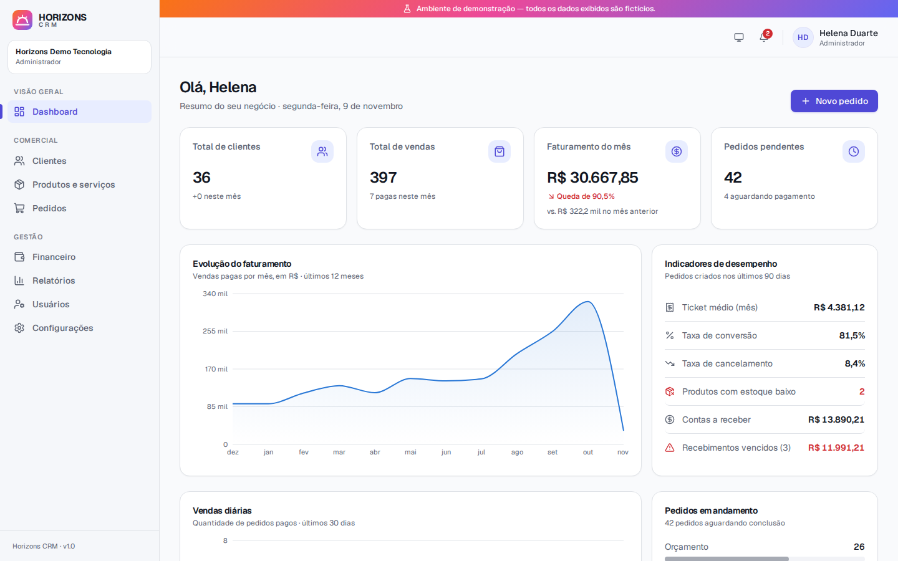

</div>

---

## Sumário

- [Apresentação](#apresentação)
- [Funcionalidades](#funcionalidades)
- [Tecnologias](#tecnologias)
- [Arquitetura](#arquitetura)
- [Estrutura de diretórios](#estrutura-de-diretórios)
- [Executando o projeto](#executando-o-projeto)
- [Variáveis de ambiente](#variáveis-de-ambiente)
- [Testes](#testes)
- [Credenciais de demonstração](#credenciais-de-demonstração)
- [Documentação da API](#documentação-da-api)
- [Segurança](#segurança)
- [Regras de negócio](#regras-de-negócio)
- [Capturas de tela](#capturas-de-tela)
- [Limitações conhecidas](#limitações-conhecidas)

## Apresentação

O **Horizons CRM** é uma aplicação full-stack completa para gestão comercial de pequenas empresas. Cada empresa
cria sua conta (organização), convida a equipe com funções e permissões diferentes e passa a controlar clientes,
catálogo, pedidos, estoque e financeiro em um só lugar.

### Objetivo

Demonstrar, em um projeto de portfólio, a construção de um sistema **funcional de ponta a ponta**: modelagem de
dados, API REST segura com regras de negócio reais, isolamento multiempresa, interface profissional e
responsiva, testes automatizados, documentação e infraestrutura com Docker e CI.

Nada é simulado: todos os indicadores vêm do banco de dados, todos os botões executam ações reais e os dados de
demonstração são claramente identificados como fictícios.

## Funcionalidades

| Módulo | O que faz |
|---|---|
| **Autenticação** | Cadastro de empresa + administrador, login, logout, sessão com cookie `httpOnly`, troca de senha (encerra outras sessões), perfil |
| **Dashboard** | Total de clientes, vendas, faturamento do mês (com variação), pedidos pendentes, evolução mensal (12 meses), vendas diárias (30 dias), ticket médio, conversão, cancelamento, estoque baixo, contas a receber/vencidas, pedidos recentes e últimas atividades |
| **Clientes** | CRUD completo, PF/PJ com validação de CPF/CNPJ (dígitos verificadores), endereço, observações, pesquisa, filtros, ordenação, paginação, histórico de pedidos e total comprado |
| **Produtos e serviços** | CRUD, SKU único por empresa, preço, categoria, estoque e estoque mínimo, ativo/inativo, filtros (tipo, categoria, status, estoque baixo) |
| **Pedidos** | Numeração sequencial por empresa (`PED-00001`), itens com snapshot de preço, descontos por item e por pedido, cálculo de totais no servidor, fluxo de status com histórico, reserva/devolução de estoque, bloqueio de pedidos concluídos/cancelados |
| **Financeiro** | Receitas e despesas, contas a receber e a pagar, baixa, cancelamento (estorno), saldo acumulado, resultado do mês, vencidos, fluxo de caixa de 12 meses; lançamentos gerados automaticamente pelos pedidos |
| **Relatórios** | Vendas por período, clientes cadastrados, produtos mais vendidos, faturamento (receitas × despesas) e pedidos por status — com exportação **CSV** compatível com Excel |
| **Usuários e permissões** | Administrador, Gerente e Operador; criação, edição, desativação (revoga sessões) e redefinição de senha; matriz de permissões |
| **Notificações** | Estoque baixo, pagamento confirmado e pedido cancelado, com contador de não lidas |
| **Interface** | Tema claro/escuro/sistema, sidebar, layout responsivo (desktop, tablet e celular), estados de carregamento, vazios e de erro, toasts, confirmação antes de ações destrutivas, filtros sincronizados com a URL |

## Tecnologias

| Camada | Tecnologia | Por quê |
|---|---|---|
| Front-end | **Next.js 16** (App Router), **React 19**, **TypeScript** | Roteamento, build otimizado e proxy integrado para a API |
| UI | **Tailwind CSS 4**, **Radix UI** (primitivas acessíveis), **Lucide**, design system próprio | Acessibilidade (foco, teclado, ARIA) sem depender de template genérico |
| Gráficos | **Recharts** | Gráficos declarativos; paleta validada para daltonismo nos temas claro e escuro |
| Estado/forms | **TanStack Query**, **React Hook Form** | Cache, loading/erro padronizados e formulários performáticos |
| Back-end | **Node.js 22**, **Express 5**, **TypeScript** | API REST simples e consolidada; Express 5 trata erros assíncronos nativamente |
| Validação | **Zod 4** (pacote compartilhado) | Os mesmos schemas validam o formulário, a API e geram o OpenAPI |
| Banco | **PostgreSQL 17**, **Prisma 7** + migrations | Tipagem ponta a ponta e consultas parametrizadas |
| Segurança | **argon2id**, **helmet**, **express-rate-limit** | Hash de senha forte, cabeçalhos seguros e proteção contra força bruta |
| Testes | **Vitest**, **Supertest** | Testes unitários e de integração contra um PostgreSQL real |
| Infra | **Docker**, **Docker Compose**, **GitHub Actions**, **pnpm workspaces** | Ambiente reproduzível e CI automatizado |

## Arquitetura

```
┌───────────────┐   /api/*   ┌──────────────────────┐   Prisma   ┌──────────────┐
│   Navegador   │──────────▶│  Next.js (web :3000) │──────────▶│              │
│ React + Query │  cookie    │  proxy → API (:3333) │            │  PostgreSQL  │
└───────────────┘  httpOnly  └──────────┬───────────┘            │              │
                                        ▼                         └──────▲───────┘
                             ┌──────────────────────┐                    │
                             │  API Express (REST)  │────────────────────┘
                             │  auth · rbac · zod   │
                             │  módulos de negócio  │
                             └──────────────────────┘
              packages/shared ── schemas Zod, enums, permissões e regras de cálculo
```

- **Monorepo (pnpm workspaces)** com três pacotes: `apps/api`, `apps/web` e `packages/shared`.
- **Mesma origem:** o navegador chama `/api/*` no Next.js, que encaminha para a API. Sem CORS, com cookie
  `SameSite=Lax` e `httpOnly`.
- **API organizada por módulos** (`routes` → `service` → Prisma). As rotas fazem validação e autorização; os
  services concentram as regras de negócio e as transações.
- **Fonte única da verdade:** schemas Zod, enums, matriz de permissões e o cálculo de totais do pedido ficam em
  `packages/shared` e são usados pelo front-end (pré-visualização) e pelo back-end (validação definitiva).

Mais detalhes, modelo de dados e decisões técnicas em [`docs/ARCHITECTURE.md`](docs/ARCHITECTURE.md).

## Estrutura de diretórios

```
horizons-crm/
├── apps/
│   ├── api/                      # API REST (Express + Prisma)
│   │   ├── prisma/               # schema.prisma, migrations e seed de demonstração
│   │   ├── src/
│   │   │   ├── config/           # variáveis de ambiente validadas com Zod
│   │   │   ├── docs/             # especificação OpenAPI 3.1
│   │   │   ├── lib/              # prisma, erros, segurança, datas/fuso, CSV
│   │   │   ├── middlewares/      # autenticação, permissões, origem, erros
│   │   │   └── modules/          # auth, users, customers, products, orders,
│   │   │                         # finance, dashboard, reports, notifications
│   │   └── test/                 # testes unitários e de integração
│   └── web/                      # Front-end Next.js
│       └── src/
│           ├── app/(auth)/       # login e cadastro
│           ├── app/(app)/        # páginas autenticadas (dashboard, clientes...)
│           ├── components/       # design system (ui/), layout, gráficos
│           ├── features/         # componentes por domínio (formulários etc.)
│           ├── hooks/            # auth, estado na URL, exclusão
│           └── lib/              # cliente HTTP, formatação, tipos
├── packages/shared/              # schemas Zod, enums, permissões, regras de pedido
├── docs/                         # arquitetura e capturas de tela
├── docker-compose.yml
└── .github/workflows/ci.yml
```

## Executando o projeto

### Requisitos

- **Docker** e **Docker Compose** (execução completa), ou
- **Node.js 22+**, **pnpm 11+** e um **PostgreSQL 15+** (desenvolvimento local)

### Opção 1 — Docker (recomendado)

```bash
git clone <url-do-repositorio> horizons-crm
cd horizons-crm
cp .env.example .env          # ajuste POSTGRES_PASSWORD e SEED_DEMO_PASSWORD
docker compose up -d --build
```

| Serviço | Endereço |
|---|---|
| Aplicação | http://localhost:3000 |
| API | http://localhost:3333 |
| Documentação da API (Swagger) | http://localhost:3000/api/docs/ ou http://localhost:3333/docs |

No start, o contêiner da API aplica as migrations (`prisma migrate deploy`) e executa o seed de demonstração
(idempotente; desative com `RUN_SEED=false`).

### Opção 2 — Desenvolvimento local

```bash
pnpm install
cp .env.example .env                      # aponte DATABASE_URL e TEST_DATABASE_URL para o seu PostgreSQL
docker compose up -d db                   # (opcional) sobe apenas o PostgreSQL
pnpm --filter @horizons/api db:generate   # gera o Prisma Client
pnpm db:migrate                           # aplica as migrations
pnpm db:seed                              # cria a organização de demonstração
pnpm dev                                  # API em :3333 e web em :3000 (hot reload)
```

> O banco de testes (`TEST_DATABASE_URL`) precisa existir: `createdb horizons_test` ou
> `docker compose exec db createdb -U horizons horizons_test`.

## Variáveis de ambiente

Todas as variáveis ficam no `.env` da raiz (modelo em [`.env.example`](.env.example)). Nenhum segredo é versionado,
e a API valida as variáveis com Zod ao iniciar: se faltar alguma, ela não sobe.

| Variável | Descrição | Padrão |
|---|---|---|
| `POSTGRES_USER` / `POSTGRES_PASSWORD` / `POSTGRES_DB` | Credenciais do PostgreSQL do Docker Compose | `horizons` / — / `horizons` |
| `DATABASE_URL` | Conexão da API com o banco | — |
| `TEST_DATABASE_URL` | Banco exclusivo dos testes (deve ser diferente de `DATABASE_URL`) | — |
| `API_PORT` | Porta da API | `3333` |
| `WEB_ORIGIN` | Origens permitidas para requisições que alteram dados (separadas por vírgula) | `http://localhost:3000` |
| `SESSION_TTL_HOURS` | Duração da sessão | `168` (7 dias) |
| `COOKIE_SECURE` | Cookie com flag `Secure` (use `true` com HTTPS) | `false` |
| `APP_TIMEZONE` | Fuso usado em agregações por dia/mês | `America/Sao_Paulo` |
| `SEED_DEMO_PASSWORD` | Senha das contas de demonstração (vazia = seed não executa) | — |
| `RUN_SEED` | Executa o seed no start do contêiner da API | `true` |
| `API_INTERNAL_URL` | Endereço da API usado pelo proxy do Next.js | `http://localhost:3333` |

## Testes

```bash
pnpm test          # todos os pacotes
pnpm typecheck     # verificação de tipos
pnpm lint          # ESLint (web) + tsc
```

**99 testes automatizados:**

| Pacote | Tipo | Cobertura |
|---|---|---|
| `packages/shared` (22) | Unitários | Cálculo de totais e descontos, máquina de estados do pedido, CPF/CNPJ, schemas, matriz de permissões |
| `apps/api` (72) | Unitários + **integração** com PostgreSQL real | Autenticação e sessões, CSRF/origem, rate limit, clientes, produtos, pedidos (fluxo completo, estoque, estornos, concorrência), financeiro, **permissões por função**, **isolamento entre organizações** (IDOR), dashboard, relatórios, CSV, fuso horário |
| `apps/web` (5) | Unitários | Formatação de moeda, datas e query strings |

Os testes de integração sobem a aplicação Express em memória (Supertest) e usam um banco PostgreSQL de testes
separado. As migrations são aplicadas automaticamente, e cada cenário cria as próprias organizações, então os
testes não dependem de ordem nem de banco vazio. O GitHub Actions roda lint, tipos, testes, build e o build das
imagens Docker a cada push.

## Credenciais de demonstração

O seed cria a organização **Horizons Demo Tecnologia**, marcada como demonstração: a interface exibe uma faixa
"Ambiente de demonstração — todos os dados exibidos são fictícios". São 36 clientes, 18 produtos e serviços, cerca
de 450 pedidos distribuídos em 12 meses e lançamentos financeiros coerentes com esses pedidos.

| Função | E-mail | Senha |
|---|---|---|
| Administrador | `admin@horizons.demo` | valor de `SEED_DEMO_PASSWORD` (no `.env.example`: `Demo@2026`) |
| Gerente | `gerente@horizons.demo` | idem |
| Operador | `operador@horizons.demo` | idem |

Também é possível criar uma conta nova em **Criar conta da empresa**. Ela começa vazia e fica totalmente
isolada da organização de demonstração.

## Documentação da API

A especificação **OpenAPI 3.1** é gerada a partir dos mesmos schemas Zod usados na validação:

- Swagger UI: `http://localhost:3333/docs` (ou `/api/docs/` pelo front-end)
- JSON: `http://localhost:3333/openapi.json`

Convenções:

- **Autenticação:** cookie `hz_session`, obtido em `POST /auth/login`.
- **Respostas:** `{ data }` para um registro e `{ data, meta: { page, pageSize, total, totalPages } }` para listas.
- **Erros:** `{ error: { code, message, details? } }`.
- **Valores monetários:** inteiros em **centavos**. Datas de calendário no formato `AAAA-MM-DD`.

| Recurso | Endpoints principais |
|---|---|
| Auth | `POST /auth/register` · `POST /auth/login` · `POST /auth/logout` · `GET /auth/me` · `PATCH /auth/profile` · `POST /auth/password` |
| Clientes | `GET/POST /customers` · `GET/PUT/DELETE /customers/:id` |
| Produtos | `GET/POST /products` · `GET/PUT/DELETE /products/:id` · `GET /products/categories` |
| Pedidos | `GET/POST /orders` · `GET/PUT/DELETE /orders/:id` · `PATCH /orders/:id/status` |
| Financeiro | `GET/POST /finance/entries` · `PUT/DELETE /finance/entries/:id` · `POST /finance/entries/:id/pay` · `POST /finance/entries/:id/cancel` · `GET /finance/summary` · `GET /finance/cashflow` |
| Relatórios | `GET /reports/:type` · `GET /reports/:type/export` (CSV) |
| Outros | `GET /dashboard` · `GET /activities` · `GET/POST /users` · `PATCH /users/:id` · `POST /users/:id/password` · `GET /notifications` |

## Segurança

| Ameaça | Proteção |
|---|---|
| Vazamento de senhas | **argon2id** (parâmetros OWASP); o hash nunca é retornado pela API |
| Roubo/sequestro de sessão | Token aleatório de 256 bits em cookie `httpOnly` + `SameSite=Lax` (+ `Secure` com HTTPS); o banco guarda apenas o **SHA-256** do token; sessões revogáveis (logout, troca de senha, desativação) |
| Enumeração de usuários | Mensagem genérica no login e verificação de hash fictício quando o e-mail não existe, para igualar o tempo de resposta |
| Força bruta | Rate limit em login, cadastro e troca de senha |
| CSRF | `SameSite=Lax` + validação do cabeçalho `Origin` em métodos que alteram estado |
| Acesso indevido (vertical) | RBAC verificado **no servidor** em cada rota; a função é lida do banco a cada requisição |
| Acesso horizontal / IDOR | Toda consulta é filtrada pelo `organizationId` da sessão (nunca do corpo da requisição); recursos de outra empresa retornam **404** |
| SQL Injection | Prisma (consultas parametrizadas); SQL bruto só via *tagged templates* parametrizados |
| Entradas maliciosas | Validação Zod de corpo, query e parâmetros; limite de 100 kB no corpo |
| CSV/Formula Injection | Células iniciadas por `= + - @` são neutralizadas na exportação |
| Exposição de erros | Handler central: erros inesperados são registrados no servidor e o cliente recebe uma mensagem genérica |
| Cabeçalhos | `helmet` na API; `X-Frame-Options`, `nosniff`, `Referrer-Policy` e `Permissions-Policy` no front |
| Open redirect | O parâmetro `?next=` do login aceita apenas caminhos internos |
| Segredos | Somente em variáveis de ambiente, validadas no start; `.env` fora do Git |

## Regras de negócio

**Fluxo do pedido**

```
Orçamento ──▶ Aguardando pagamento ──▶ Pago ──▶ Em processamento ──▶ Concluído
    │              │   ▲                 │              │
    │              ▼   │ (volta)         │              │
    └──────────────┴───┴─────────▶ Cancelado ◀──────────┘
```

- Totais sempre **calculados no servidor**, em centavos inteiros, com o preço cadastrado do produto (o cliente
  não envia preço). Descontos nunca podem superar o valor ao qual se aplicam.
- Itens, cliente e descontos só podem ser alterados em **Orçamento** ou **Aguardando pagamento**.
  **Concluído** e **Cancelado** são estados finais.
- **Aguardando pagamento:** reserva o estoque de forma atômica (`UPDATE ... WHERE stock >= qtd`) e gera a
  **conta a receber**. Se faltar estoque, nada é alterado e a transação inteira é desfeita.
- **Pago:** baixa a conta a receber e passa a contar no faturamento.
- **Cancelado:** devolve o estoque, cancela cobranças pendentes e, se o pedido já tinha sido pago, registra o
  **estorno** como despesa, mantendo o saldo coerente.
- Concorrência: as mudanças de status usam bloqueio otimista. Se outro usuário alterou o pedido antes, a
  operação é recusada.
- Lançamentos financeiros gerados por pedidos são **bloqueados** para edição manual. Lançamentos pagos não podem
  ser excluídos, apenas cancelados.
- Clientes e produtos com vendas não podem ser excluídos (preservação do histórico); produtos podem ser
  desativados.

**Permissões por função**

| Área | Administrador | Gerente | Operador |
|---|:---:|:---:|:---:|
| Dashboard | ✅ | ✅ | ✅ (sem dados financeiros) |
| Clientes | ✅ | ✅ | Criar/editar (sem excluir) |
| Produtos | ✅ | ✅ | Somente leitura |
| Pedidos | ✅ | ✅ | Criar/editar/avançar status (sem cancelar) |
| Financeiro | ✅ | ✅ | — |
| Relatórios | ✅ | ✅ | — |
| Usuários | ✅ | — | — |

## Capturas de tela

| | |
|---|---|
| 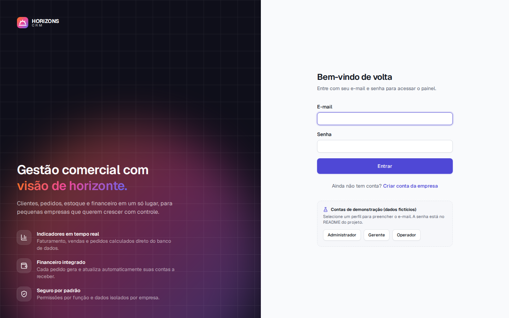 **Login** com acesso às contas de demonstração | 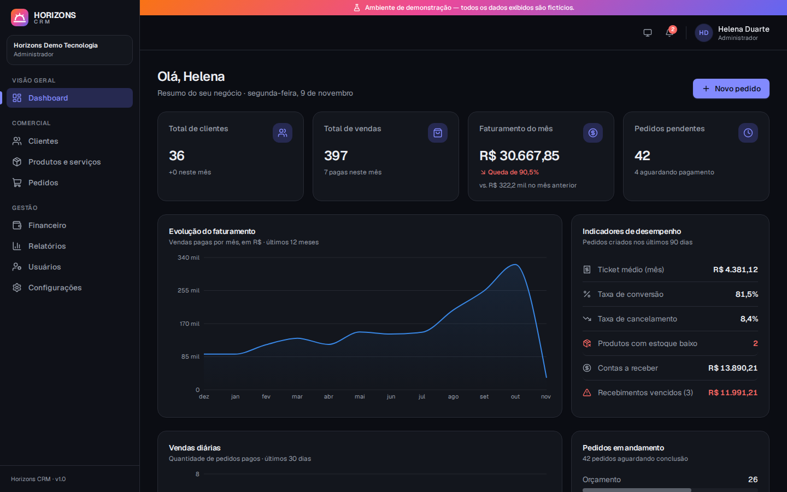 **Dashboard** no tema escuro |
| 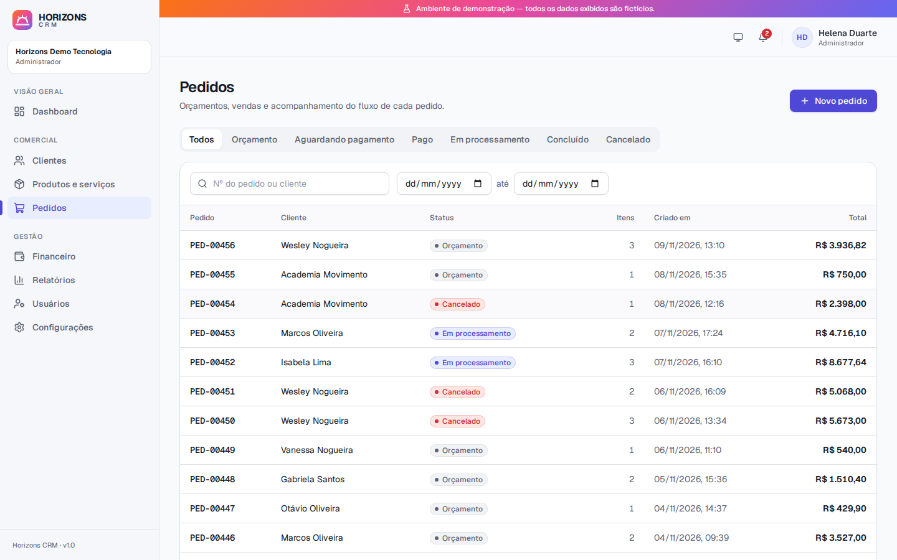 **Pedidos** com filtros por status e período | 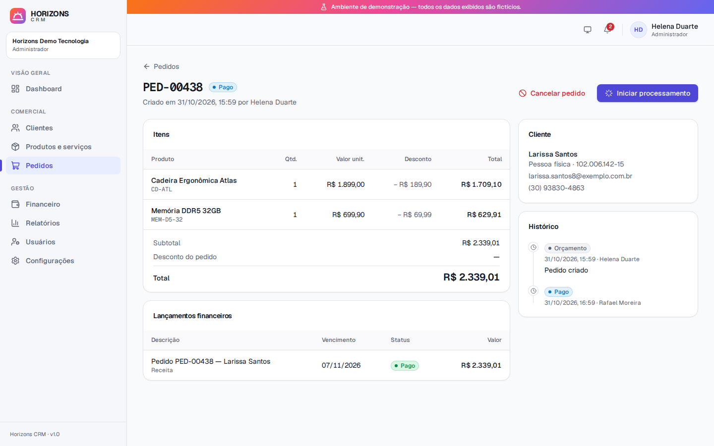 **Pedido** com fluxo de status, financeiro e histórico |
| 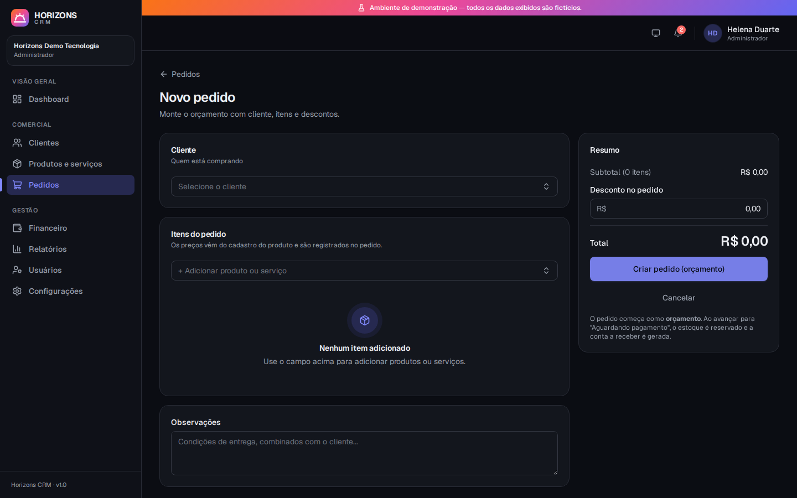 **Novo pedido** com totais em tempo real | 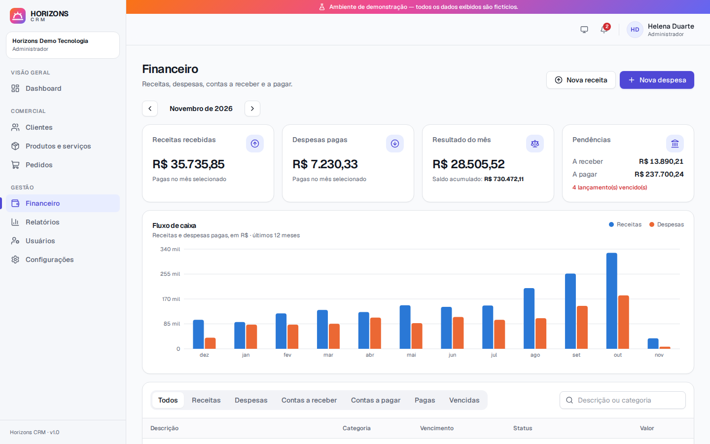 **Financeiro** com fluxo de caixa |
| 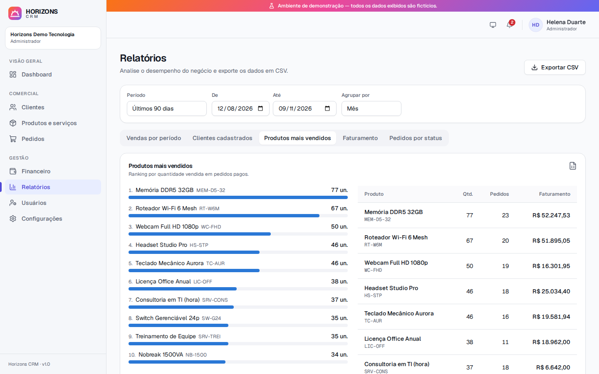 **Relatórios** com exportação CSV | 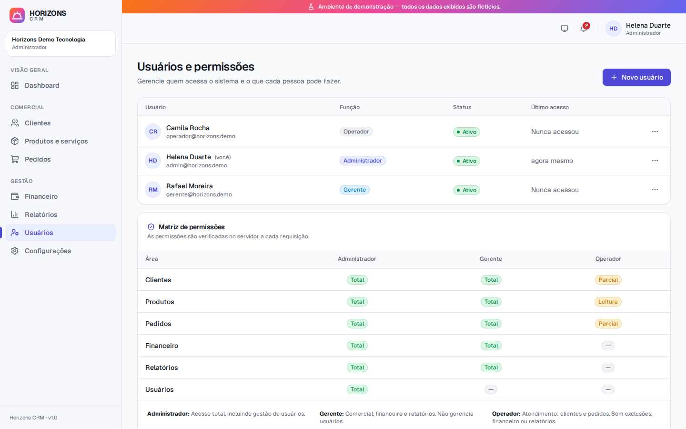 **Usuários** e matriz de permissões |
| 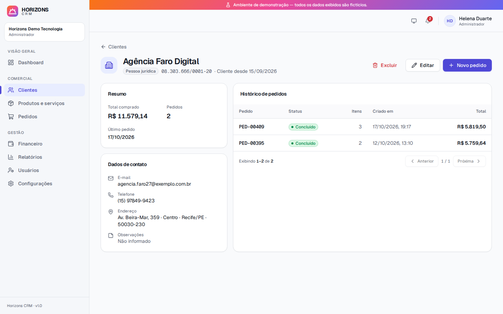 **Cliente** com histórico de pedidos | 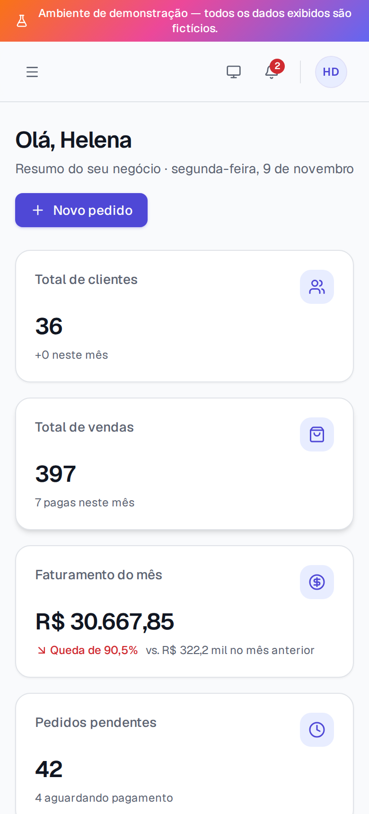 **Responsivo** em celulares |

## Limitações conhecidas

- **Sem gateway de pagamento:** a confirmação de pagamento é manual, como definido no escopo desta versão.
- **Sem envio de e-mails:** não há recuperação de senha por e-mail nem convites. O administrador define e redefine
  as senhas da equipe.
- **Um usuário pertence a uma única organização**, e o e-mail é único no sistema.
- **Moeda única (BRL)**, valores em centavos inteiros (até R$ 10 milhões por item/lançamento) e um fuso por
  instalação (`APP_TIMEZONE`).
- **Editar um pedido** atualiza os preços dos itens para os valores atuais do cadastro.
- **Notificações** são atualizadas por consulta periódica (60 s), sem WebSocket.
- **Rate limit em memória:** em várias instâncias da API, seria necessário um armazenamento compartilhado
  (ex.: Redis).
- **Sem testes end-to-end automatizados no CI:** os fluxos de interface foram verificados com Playwright durante o
  desenvolvimento, mas esses scripts não fazem parte da suíte.

## Autor

Desenvolvido por **Diego Oliveira da Silva**.
